# NQ "pyramid up" backtest, 2022 to 2026

**The strategy tested.** Each January, buy 1 unit of NQ. Every time price rises another 1%, add 1 unit. **Every unit, including the first, has its own stop 1% below its entry.** The idea: accept many small whipsaw losses in exchange for a very large position (and profit) if the market trends up. Each calendar year runs from the January open to the December close: 2022, 2023, 2024, 2025, and 2026 to date.

All dollar figures are for **1 unit = 1 NQ contract ($20 per point)**. **For MNQ, divide every dollar figure by 10.** Figures are net of costs (0.5 pt slippage plus $2.50 commission per contract per side). The 2026 run stops at the **November 2, 2026** close (year to date).

**Start here:** [Which version is best? Sized properly](#which-version-is-best-sized-properly-100k-per-unit-no-reinvestment) compares every version at a constant $100k per unit (Calmar ratio and the account size you need). The chosen version with 20-delta calls is in [The chosen version with 20-delta calls](#the-chosen-version-with-20-delta-calls-sized-at-100k-per-unit).

**Also:** a version that only starts the pyramid when NQ recovers from a 5% pullback is in [Only trading recoveries from 5% pullbacks](#only-trading-recoveries-from-5-pullbacks). The same strategy over 2008 to 2026, with variants and covered calls, is in [2008 to 2026](#2008-to-2026-recovery-entries-variants-and-covered-calls). A breakout version (beat the 1-year high after a 3% pullback, +5% target, 0.5% steps) is in [Breakout entries](#breakout-entries-beating-the-1-year-high-after-a-3-pullback). Entering at 30% of the rebound, with 20-delta calls, is in [Recovery entries at 30%](#recovery-entries-at-30-of-the-rebound-with-20-delta-calls).

## Which version is best? Sized properly: $100k per unit, no reinvestment

**Why the earlier dollar figures mislead.** Every earlier table used 1 NQ contract per unit and never reinvested. But one contract was worth about $24k of NQ in 2009 and $563k in 2026, so the same 1% move was worth about 20 times more dollars in recent years. That is why the big drawdowns all show up late, after large profits had already been banked. For example, the 70% recovery version's worst drawdown ran from Dec 16, 2024 (cumulative profit $965k) to Jun 22, 2025 ($608k).

**Method here.** Every run is sized so that **1 unit = $100k of NQ at the run's start**, and profits are never reinvested.
- For the pyramid from January and buy & hold, a run is each January.
- For the recovery and breakout versions, a run is each campaign.
- Contracts can be fractional, and costs are scaled to match. The rules and data are unchanged.

**Calmar** = average profit per year ÷ worst peak-to-trough drawdown. Both are in dollars per $100k unit, so the ratio does not depend on the unit size.

| Version | Average profit per year | Worst drawdown | When | Calmar | Yearly avg / std. dev. | Worst year | Losing years | Max units held |
|---|---:|---:|---|---:|---:|---:|---:|---:|
| Pyramid from the January open (D) | +$204k | -$646k | 02 Sep 2020 – 24 Sep 2020 | **0.32** | 0.55 | -$255k | 7 of 19 | 46 |
| Buy & hold ($100k each January) | +$17k | -$57k | 02 Jan 2008 – 09 Mar 2009 | **0.29** | 0.65 | -$44k | 3 of 19 | 1 |
| Recovery 70%, reset +20% | +$59k | -$217k | 30 Aug 2018 – 10 Oct 2019 | **0.27** | 0.52 | -$129k | 6 of 19 | 19 |
| Recovery 61.8%, reset +20% | +$65k | -$253k | 30 Aug 2018 – 10 Oct 2019 | **0.25** | 0.50 | -$150k | 7 of 19 | 19 |
| Recovery 50%, reset +20% | +$67k | -$283k | 30 Aug 2018 – 03 Oct 2019 | **0.24** | 0.48 | -$175k | 7 of 19 | 19 |
| Recovery, entry 61.8% | +$36k | -$154k | 28 Nov 2014 – 28 Jun 2016 | **0.23** | 0.53 | -$98k | 5 of 19 | 12 |
| Breakout, 8% pullback, +4% target | +$7k | -$34k | 04 Nov 2015 – 31 Oct 2019 | **0.22** | 0.61 | -$9k | 4 of 19 | 8 |
| Recovery 70%, no reset | +$124k | -$638k | 02 Sep 2020 – 24 Sep 2020 | **0.19** | 0.40 | -$129k | 7 of 19 | 45 |
| Recovery 70%, reset +16% | +$39k | -$217k | 30 Aug 2018 – 10 Oct 2019 | **0.18** | 0.43 | -$129k | 6 of 19 | 15 |
| Recovery, entry 50% | +$35k | -$207k | 02 May 2011 – 05 Jul 2013 | **0.17** | 0.44 | -$145k | 4 of 19 | 12 |
| Recovery, entry 30% | +$32k | -$192k | 13 Mar 2018 – 03 Apr 2020 | **0.16** | 0.42 | -$104k | 6 of 19 | 12 |
| Recovery 61.8%, reset +16% | +$39k | -$253k | 30 Aug 2018 – 10 Oct 2019 | **0.15** | 0.40 | -$150k | 7 of 19 | 15 |
| Recovery, entry 40% | +$31k | -$238k | 02 May 2011 – 05 Jul 2013 | **0.13** | 0.34 | -$162k | 6 of 19 | 12 |
| Recovery, entry 20% | +$34k | -$266k | 06 Jun 2008 – 12 Mar 2009 | **0.13** | 0.41 | -$159k | 5 of 19 | 12 |
| Recovery, entry 70% (base) | +$23k | -$188k | 26 Apr 2010 – 27 Aug 2013 | **0.12** | 0.46 | -$84k | 5 of 19 | 12 |
| Recovery 70%, 8% pullback | +$21k | -$182k | 26 Apr 2010 – 21 May 2014 | **0.12** | 0.51 | -$82k | 5 of 19 | 12 |
| Recovery, entry 80% | +$20k | -$174k | 30 Aug 2018 – 23 Oct 2019 | **0.12** | 0.36 | -$110k | 6 of 19 | 12 |
| Breakout as specified (3% / +5% / 0.5%) | +$1k | -$98k | 02 Mar 2015 – 31 Oct 2019 | **0.01** | 0.07 | -$29k | 8 of 19 | 10 |

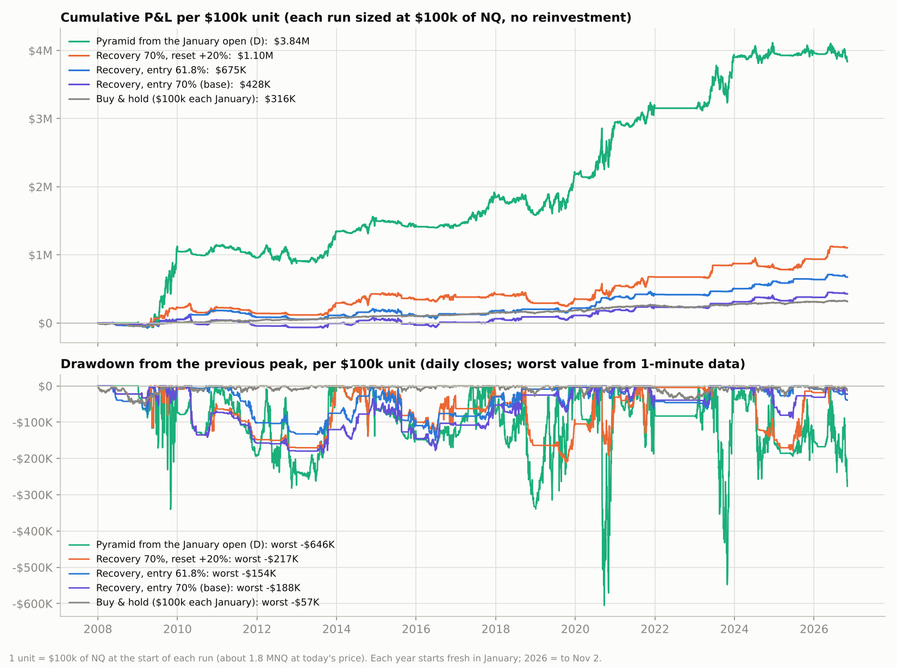

**The top versions, year by year (per $100k unit):**

| Year | Pyramid from January (D) | Recovery 70%, reset +20% | Recovery 61.8%, reset +12% | Buy & hold |
|---|---:|---:|---:|---:|
| 2008 | -$1k | -$22k | -$37k | -$44k |
| 2009 | +$1.05M | +$246k | +$91k | +$55k |
| 2010 | +$78k | +$180 | +$128k | +$18k |
| 2011 | -$171k | -$84k | -$98k | +$2k |
| 2012 | -$45k | -$22k | -$31k | +$13k |
| 2013 | +$435k | +$175k | +$57k | +$33k |
| 2014 | +$148k | +$132k | +$68k | +$21k |
| 2015 | -$80k | -$82k | -$78k | +$7k |
| 2016 | +$5k | +$37k | +$26k | +$10k |
| 2017 | +$421k | +$40k | +$53k | +$32k |
| 2018 | -$255k | -$129k | +$21k | -$3k |
| 2019 | +$598k | +$59k | +$17k | +$40k |
| 2020 | +$765k | +$197k | +$168k | +$49k |
| 2021 | +$206k | +$128k | +$32k | +$27k |
| 2022 | -$2k | $0 | -$3k | -$34k |
| 2023 | +$750k | +$197k | +$88k | +$46k |
| 2024 | +$52k | -$66k | +$108k | +$21k |
| 2025 | +$5k | +$131k | +$27k | +$15k |
| 2026 YTD | -$123k | +$168k | +$37k | +$6k |

**How much account you need.** The smallest practical unit is 1 MNQ, which is $56,255 of NQ at today's price (28,127.50). Everything scales linearly with the unit size; the table uses 1 unit = 1 MNQ.

| Version | Worst drawdown | Max MNQ held | Account if worst drawdown = 50% | Account if = 33% | Average profit per year | Yearly return on the 33% account |
|---|---:|---:|---:|---:|---:|---:|
| Pyramid from the January open (D) | -$363k | 46 | $727k | $1,090k | +$115k | 11% |
| Recovery 70%, reset +20% | -$122k | 19 | $244k | $366k | +$33k | 9% |
| Recovery 61.8%, reset +20% | -$143k | 19 | $285k | $428k | +$36k | 8% |
| Recovery, entry 61.8% | -$86k | 12 | $173k | $259k | +$20k | 8% |
| Recovery, entry 70% (base) | -$106k | 12 | $212k | $317k | +$13k | 4% |
| Breakout, 8% pullback, +4% target | -$19k | 8 | $38k | $57k | +$4k | 7% |
| Buy & hold ($100k each January) | -$32k | 1 | $65k | $97k | +$9k | 10% |

**The pick and what it means:**

- **Best Calmar: the original pyramid from the January open (D), at 0.32.** That is only slightly better than buy & hold (0.29), and D needs by far the most capital: up to 46 units at the peak, and a worst drawdown of -$646k per $100k unit.
  - That drawdown happened in 3 weeks (Sep 2–24, 2020), right after the pyramid had grown to 40+ units in the 2020 rally.
  - D's profits also come from a few big years: 2009 alone is +$1.05M of its +$3.84M.
- **Best of the recovery versions: 70% entry with a +20% reset (Calmar 0.27).** It needs about a third of D's capital for similar risk-adjusted returns.
  - The 61.8% / +12% version, which looked best on 1-contract dollars, drops to 0.23.
  - The 70% / +12% base drops to 0.12, worse than buy & hold. The 1-contract ranking was distorted by the price level.
- **Per unit of yearly volatility, buy & hold is still best** (0.65 against 0.50–0.55). None of the pyramids clearly beats simply holding NQ on risk-adjusted terms; they trade higher returns for proportionally larger drawdowns.
- **Return on capital ≈ Calmar × the drawdown you accept.** If you size so the worst historical drawdown would have been a third of your account, expect roughly 8–11% a year (non-compounded) from the top versions, against about 10% for buy & hold.
- **With a $100k account, the pyramids don't fit, even at the minimum size of 1 MNQ per unit.** The worst drawdown would have been about $86k (61.8% recovery version), $122k (70% / +20%) or $363k (pyramid from January). Only buy & hold (worst about $32k per MNQ) or the small 8% / +4% breakout version (about $19k, but only about $4k a year) stay within a $100k account.
- **Margin at the peak position is roughly $3k per MNQ** (check your broker): about $150k for D's 46 MNQ, $60k for 19 and $40k for 12. The accounts in the table above cover it.
- **Plan for worse than history.** Calmar rests on a single worst event, and the next one can be bigger. A common rule is to size for 1.5–2 times the historical worst drawdown.

Files: `results/sizing/` (ranking with per-year results, daily equity per $100k unit, current MNQ value). Code: `src/run_sizing.py`; all engines take a `unit_notional` setting.

## The chosen version with 20-delta calls (sized at $100k per unit)

**Setup.**
- **Strategy:** the pick from the section above, recovery with a 70% entry and a +20% reset (5% pullback, 1% step and 1% stop).
- **Sizing:** $100k of NQ per unit at the start of each campaign, never reinvested.
- **Calls:** sell 1 call per contract held, at 20 delta with 30 or 7 days to expiry. Sell it when the contract is bought, buy it back when the contract is sold, and roll it if it expires first. Option spreads and commissions are included.
- **Pricing:** there is no free NQ option history, so calls are priced with Black-76 from VXN (Nasdaq-100 implied volatility) plus a skew. The test is run at three price levels: 0.8, 0.9 (base) and 1.0 × VXN.

| Version (per $100k unit) | Calls priced at | Average profit per year | Option P&L, 2008-2026 (after costs) | Worst drawdown | When | Calmar | Yearly avg / std. dev. |
|---|---:|---:|---:|---:|---|---:|---:|
| No calls |  | +$59k |  | -$217k | Aug 2018 – Oct 2019 | **0.27** | 0.52 |
| Sell 20-delta 30-day calls | 0.8 x VXN | +$44k | -$277k | -$189k | Sep 2020 – Nov 2020 | 0.23 | 0.49 |
| Sell 20-delta 30-day calls | 0.9 x VXN (base) | +$55k | -$66k | -$186k | Sep 2020 – Nov 2020 | **0.30** | 0.58 |
| Sell 20-delta 30-day calls | 1.0 x VXN | +$65k | +$122k | -$183k | Sep 2020 – Nov 2020 | 0.36 | 0.64 |
| Sell 20-delta 7-day calls | 0.8 x VXN | +$57k | -$29k | -$199k | Jul 2024 – Jun 2025 | 0.29 | 0.54 |
| Sell 20-delta 7-day calls | 0.9 x VXN (base) | +$75k | +$302k | -$183k | Jul 2024 – Jun 2025 | **0.41** | 0.65 |
| Sell 20-delta 7-day calls | 1.0 x VXN | +$90k | +$593k | -$169k | Jul 2024 – Jun 2025 | 0.53 | 0.73 |

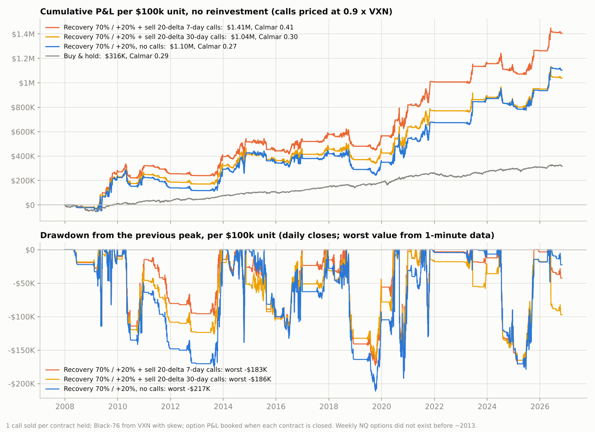

| Year | No calls | + 20-delta 30-day calls | + 20-delta 7-day calls | 7-day calls added |
|---|---:|---:|---:|---:|
| 2008 | -$22k | -$17k | -$19k | +$4k |
| 2009 | +$246k | +$248k | +$290k | +$44k |
| 2010 | +$180 | +$19k | +$50k | +$49k |
| 2011 | -$84k | -$62k | -$66k | +$19k |
| 2012 | -$22k | -$15k | -$15k | +$7k |
| 2013 | +$175k | +$150k | +$156k | -$19k |
| 2014 | +$132k | +$92k | +$120k | -$13k |
| 2015 | -$82k | -$51k | -$73k | +$9k |
| 2016 | +$37k | +$52k | +$77k | +$40k |
| 2017 | +$40k | +$41k | +$58k | +$18k |
| 2018 | -$129k | -$85k | -$97k | +$32k |
| 2019 | +$59k | +$54k | +$85k | +$26k |
| 2020 | +$197k | +$215k | +$254k | +$57k |
| 2021 | +$128k | +$131k | +$188k | +$60k |
| 2022 | $0 | $0 | $0 | $0 |
| 2023 | +$197k | +$111k | +$150k | -$48k |
| 2024 | -$66k | -$64k | -$68k | -$2k |
| 2025 | +$131k | +$131k | +$174k | +$43k |
| 2026 YTD | +$168k | +$89k | +$144k | -$24k |

**Account needed at 1 MNQ per unit** (1 MNQ ≈ $56k of NQ today; calls on MNQ options):

| Version, 1 unit = 1 MNQ | Worst drawdown | Account if worst drawdown = 50% | Account if = 33% | Average profit per year | Yearly return on the 33% account |
|---|---:|---:|---:|---:|---:|
| No calls | -$122k | $244k | $366k | +$33k | 9% |
| + 20-delta 30-day calls | -$105k | $209k | $314k | +$31k | 10% |
| + 20-delta 7-day calls | -$103k | $206k | $310k | +$42k | 14% |
| + 20-delta 7-day calls, priced 0.8 x VXN | -$112k | $224k | $336k | +$32k | 10% |

**What this means:**

- **Weekly 20-delta calls improved this version** at the base option pricing.
  - Calmar rose from 0.27 to 0.41, and average profit from +$59k to +$75k a year per $100k unit.
  - The worst drawdown shrank from -$217k to -$183k.
  - With cheaper calls (0.8 × VXN), profit is about the same (+$57k), but the smaller drawdown still lifts Calmar slightly (0.29). With richer calls (1.0 × VXN), Calmar reaches 0.53.
- **Where they help:** in choppy years when the pyramid keeps getting stopped (2018: +$32k, 2011: +$19k) and in steady, grinding rallies (2020–2021: +$57–60k a year). The calls earn their time value and lose value whenever price drops, which offsets part of the stop-outs.
- **Where they hurt:** in sharp rallies, where they cap the upside: 2013 (-$19k), 2023 (-$48k) and 2026 (-$24k).
  - At base pricing, the weekly calls added money in 13 of 19 years.
  - +$179k of their +$302k came in 2013–2026, when weekly options existed; the 2008–2012 part is hypothetical.
- **Monthly 20-delta calls are a coin flip:** Calmar 0.23 to 0.36 depending on pricing. They gave back $40–87k in strong years (2014, 2023, 2026).
- **At 1 MNQ per unit, with the weekly calls:**
  - The account needed for a 33% worst drawdown falls from $366k to $310k.
  - The yearly return on that account rises from 9% to 14% (10% if calls are priced at 0.8 × VXN).
- **Caveats.**
  - These are modelled option prices. Real weekly MNQ option spreads can be wider, so check live quotes before relying on the base case.
  - It is also operational work: about 240 call sales a year in this test, plus a buy-back at every stop-out.

Files: `results/best_calls/` (summary, per-year results, daily equity, trades with contract sizes). Code: `src/run_best_calls.py`.

## The answer

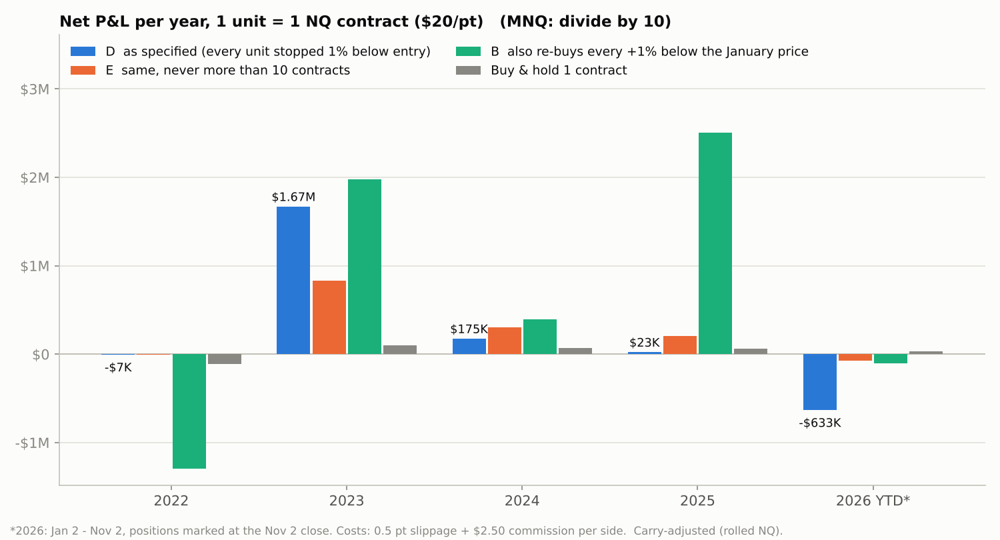

**Strategy as specified (variant D):** every unit has a 1% stop, and units are bought at the January price and at every +1% level above it. A stopped unit is bought again when price climbs back through its level.

| Year | NQ move* | Buy & hold 1 NQ | **Pyramid (as specified)** | Whipsaw stop-outs | Cost of stop-outs | P&L of units held at the end | Max contracts | Worst drawdown from peak |
|---|---:|---:|---:|---:|---:|---:|---:|---:|
| 2022 | -33.8% | -$111k | **-$7k** | 2 | -$7k | $0 | 2 | -$11k |
| 2023 | +45.9% | +$102k | **+$1.67M** | 160 | -$435k | +$2.10M | 39 | -$1.34M |
| 2024 | +20.7% | +$70k | **+$175k** | 142 | -$539k | +$714k | 25 | -$912k |
| 2025 | +14.8% | +$63k | **+$23k** | 96 | -$453k | +$476k | 19 | -$824k |
| 2026 YTD | +6.4% | +$33k | **-$633k** | 130 | -$750k | +$117k | 19 | -$1.41M |
| **Total** | | **+$157k** | **+$1.23M** | 530 | -$2.18M | +$3.41M | | |

\*NQ move is for a rolled front-month NQ position (index move minus futures financing), from the open of the first January session to the close of the last December session.

**In short:** over 2022 to November 2026, the pyramid made **+$1.23M per 1-NQ unit (+$123k with MNQ)**. Holding one contract made +$157k. But one year produced all of the profit: **2023, with +$1.67M**. The other years went like this:

- **2022 lost only $7k.** The first unit was stopped on January 4 and NQ never came back to the January price.
- **2024 and 2025 made little**: +$175k and +$23k, small next to their $0.8M to $0.9M drawdowns.
- **2026 so far is -$633k.** The pyramid was at its largest (19 contracts at the October 6 high) when NQ fell about 11% by November 2. At its June peak, 2026 had been **+$770k**.

Profitable years still came with drawdowns of **$0.8M to $1.3M per NQ unit**.

## Conclusions you can use

1. **The strategy is a bet on trend strength against volatility, and the break-even point can be calculated.** The pyramid makes money only when **(log move above the January price)² > realised variance accumulated while it was active**. In plain terms: the year has to finish more than about one annual volatility above the January price. For NQ that is roughly **+18% to +25%** before the pyramid pays anything. The "edge ratio" was 4.43 in 2023 (a big win), 1.16 in 2024 and 0.93 in 2025 (about break-even), and 0.15 in 2026 so far (a large loss). The formula predicts the backtest closely (table in [Why it behaves like this](#why-it-behaves-like-this)).
2. **Budget the whipsaws as the price you pay for the position.** The expected number of stop-outs is about **realised variance ÷ (2 × step²)**. That works out to 95 to 160 per year whenever NQ trades around or above the January price. Each one costs about 1% of the NQ price: about $2.7k per NQ contract in 2023 and about $5.8k in 2026, at higher index levels. That is **$0.43M to $0.75M per year per NQ unit (MNQ: $43k to $75k)**. You pay it whether or not the trend comes.
3. **All of the profit comes from units still open at the end; every stopped unit is a loss.** The result therefore depends heavily on where the year ends relative to the path. 2026 went from +$770k in June to -$633k by November 2. Treat the year-end date as a random draw, and do not size the strategy as if you will exit at the top.
4. **Size for the drawdown, not for "1 unit".** The position grows by about 1 contract per 1% of rally: 39 contracts and about $12.8M of NQ notional at the 2023 peak, per unit. Even winning years dropped $0.8M to $1.3M from their peaks, and 2024 at one point stood $313k below its starting equity. **With 1 unit = 1 MNQ, plan for drawdowns of about $80k to $140k.**
5. **The step size is a leverage dial, not an edge.** Halving the step roughly doubles the profit, the drawdown and the maximum position. The ratio of total P&L to worst drawdown is about 0.85 to 1.25 for 0.5%, 1%, 2% and 3% steps alike, and each year keeps its sign (2025 stays near zero in every setting). Pick the step that fits your risk budget: 2% steps carry about half the risk of 1% steps. **Stop width barely matters.** A 3% stop instead of 1% changed the 5-year total by about +11% with 3.4 times fewer trades, so wider stops cost less and need less management.
6. **A cap on the pyramid helped (variant E), with a caveat.** Variant E never holds more than 10 contracts. It made **+$1.26M with a worst drawdown of -$756k**, versus +$1.23M and -$1.41M without the cap. Its 2026 loss so far is -$72k instead of -$633k. The cost is upside in a very strong trend year: 2023 made +$0.83M instead of +$1.67M. The caveat: I chose the cap after seeing these 5 years, so treat it as a sensible risk control rather than a proven improvement.
7. **Do not re-buy below the January price without a trend filter (variant B).** In B, once the first unit is stopped, a unit is bought on every +1% bounce at any price. It had the largest total (+$3.48M), because it caught the whole April 2025 rebound (+$2.50M that year). It also **lost $1.29M in 2022, from 505 whipsaws in a volatile bear market**, and its worst drawdown was -$2.2M.
8. **Long-run reality check (model estimate, 1986 to 2025).** The strategy as specified would have been profitable in only **19 of 40 years** (13 of 26 since 2000), with a median year near zero. Its mean result was strongly positive (+1.3 to +2.3 times one contract's January value per year), driven by rare huge trend years: 1991, 1995 to 1996, 1998 to 1999, 2003, 2009, 2013, 2017, 2019 to 2020, and 2023. **Per unit of risk it was about the same as buy and hold** (mean/std 0.35 to 0.37 versus 0.36 to 0.50). It does not add edge. It turns a long-NQ view into a lottery-like payoff: frequent moderate losses and occasional very large wins. Use it when you specifically want that skew and expect a strong trend year, not as an all-weather system.

## Only trading recoveries from 5% pullbacks

Same pyramid, but it only starts when NQ climbs back out of a pullback of at least 5%:

1. **Swing high.** Track the highest price since the last reset. Once NQ is at least 5% below it, the wave is armed, and the wave low is tracked.
2. **Starting point.** Wave low + 70% × (swing high − wave low). When NQ climbs back above it, buy 1 unit.
3. **Same pyramid from there.** +1 unit at every +1% above the starting point. Each unit is stopped 1% below its entry and bought again if price climbs back through its level.
4. **Cancel.** If the selloff extends to a new low below the wave low, the campaign ends (every unit has been stopped by then). The 70% level of the extended wave becomes the new starting point.
5. **Reset at +12%.** At 12% above the starting point, sell everything and wait for the next 5% pullback.

Two interpretation choices. "12% profit" is read as price 12% above the starting point. The swing high stays at the last high before the selloff; it is not lowered to bear-market rally highs. As in the main test, each year starts fresh in January (the swing high starts at the January open) and closes at the December close. A run straight through 2022 to 2026 without the January restart is shown alongside.

| Year | Buy & hold 1 NQ | Pyramid from the January open (D) | **Recovery entries** | Recovery entries, run straight through |
|---|---:|---:|---:|---:|
| 2022 | -$111k | -$7k | **$0** | $0 |
| 2023 | +$102k | +$1.67M | **+$211k** | +$31k |
| 2024 | +$70k | +$175k | **+$127k** | +$222k |
| 2025 | +$63k | +$23k | **+$108k** | -$32k |
| 2026 YTD | +$33k | -$633k | **+$246k** | +$213k |
| **Total** | **+$157k** | **+$1.23M** | **+$692k** | **+$434k** |

Worst drawdown: **-$374k** for recovery entries (-$536k run straight through), against -$1.41M for the pyramid from the January open.

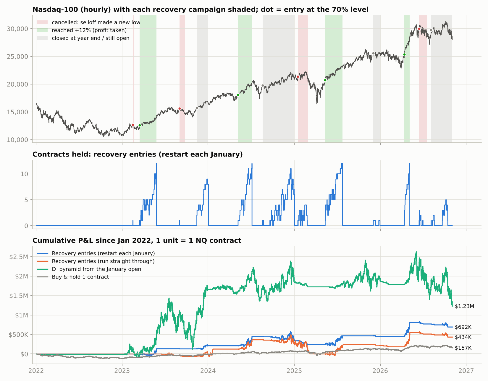

| Year | Recovery entries | Campaigns (hit +12% / cancelled) | Stop-outs | Max contracts | Time in market | Worst drawdown |
|---|---:|---:|---:|---:|---:|---:|
| 2022 | **$0** | 0 (0 / 0) | 0 | 0 | 0% | $0 |
| 2023 | **+$211k** | 4 (1 / 2) | 28 | 12 | 32% | -$75k |
| 2024 | **+$127k** | 2 (1 / 0) | 49 | 12 | 44% | -$246k |
| 2025 | **+$108k** | 3 (1 / 1) | 43 | 12 | 34% | -$144k |
| 2026 YTD | **+$246k** | 3 (1 / 1) | 23 | 12 | 22% | -$139k |
| **Total** | **+$692k** | 12 (4 / 4) | 143 | 12 | | |

**What this means:**

- **It sat out the 2022 bear market completely.** The rebounds in March, August and November 2022 never got back to 70% of the decline from the January high, so no position was taken.
- **It avoided the 2026 chop at the highs:** +$246k instead of -$633k.
- **Every year it traded was positive** (+$108k to +$246k). It never held more than 12 contracts (39 for the January pyramid) and was in the market only 22% to 44% of the time.
- **Risk-adjusted it was better, but it gives up the big trend year.** 2023 made +$211k instead of +$1.67M: the +12% reset caps each pyramid at about 12 contracts, and the strategy is flat between campaigns. The total is +$692k against +$1.23M for the January pyramid, but total ÷ worst drawdown is 1.85 against 0.87.
- **Wins are big, losses are many but smaller.** Only 4 of 12 campaigns reached +12%, and those made $136k to $366k each. Of the other 8, one made +$81k (closed at the 2023 year-end) and seven lost between $3k and $111k.
- **Results depend heavily on details: there are only 12 campaigns in five years.**
  - Running straight through instead of restarting each January gave +$434k. One campaign from August 2024 chopped for 7.5 months without reaching +12% and lost $362k when the April 2025 crash broke its low.
  - A 3% pullback trigger cut the total to +$231k (-$218k run straight through).
  - A 20% take-profit more than doubled the total (+$1.62M) but also nearly doubled the drawdown (-$702k).
  - Treat 5% / 70% / 12% as reasonable settings, not optimised ones.
- **Capping long, choppy campaigns does not help.** The expensive campaigns here were the long, choppy ones (40 to 84 stop-outs). But abandoning a campaign after 10 stop-outs or 60 days made the 2008–2026 results worse (see the next section).

**Every campaign (restart each January; prices are NQ-equivalent):**

| # | Wave: high -> low | Pullback | Entry (70% level) | Started | Ended | Outcome | Units bought / stopped | Max contracts | P&L |
|---:|---|---:|---:|---|---|---|---:|---:|---:|
| 1 | 12,961 -> 12,249 | 5.5% | 12,747 | 2023-02-15 | 2023-02-21 | cancelled (new low) | 1 / 1 | 1 | -$3k |
| 2 | 12,961 -> 11,671 | 9.9% | 12,574 | 2023-03-16 | 2023-05-26 | +12% target | 32 / 20 | 12 | +$136k |
| 3 | 15,707 -> 14,242 | 9.3% | 15,268 | 2023-09-01 | 2023-09-25 | cancelled (new low) | 1 / 1 | 1 | -$3k |
| 4 | 15,707 -> 13,585 | 13.5% | 15,071 | 2023-11-14 | 2023-12-29 | closed at year end | 14 / 6 | 9 | +$81k |
| 5 | 18,466 -> 16,883 | 8.6% | 17,991 | 2024-05-07 | 2024-07-05 | +12% target | 21 / 9 | 12 | +$238k |
| 6 | 20,496 -> 16,873 | 17.7% | 19,409 | 2024-08-19 | 2024-12-31 | closed at year end | 46 / 40 | 11 | -$111k |
| 7 | 21,873 -> 20,672 | 5.5% | 21,513 | 2025-01-16 | 2025-02-27 | cancelled (new low) | 18 / 18 | 4 | -$92k |
| 8 | 22,304 -> 16,216 | 27.3% | 20,478 | 2025-05-12 | 2025-07-25 | +12% target | 33 / 21 | 12 | +$219k |
| 9 | 25,660 -> 23,149 | 9.8% | 24,906 | 2025-12-02 | 2025-12-31 | closed at year end | 4 / 4 | 1 | -$20k |
| 10 | 26,343 -> 22,724 | 13.7% | 25,257 | 2026-04-13 | 2026-05-06 | +12% target | 15 / 3 | 12 | +$366k |
| 11 | 30,579 -> 28,013 | 8.4% | 29,809 | 2026-06-14 | 2026-07-17 | cancelled (new low) | 7 / 7 | 3 | -$42k |
| 12 | 30,579 -> 26,684 | 12.7% | 29,411 | 2026-08-04 | 2026-11-02 | open at end | 13 / 13 | 5 | -$78k |

**Sensitivity (one setting changed at a time; restart each January unless stated):**

| Setting | Value | 2022 | 2023 | 2024 | 2025 | 2026 YTD | 5-yr total | Worst drawdown | Run straight through: total | Max contracts |
|---|---:|---:|---:|---:|---:|---:|---:|---:|---:|---:|
| Pullback that arms a wave | 3% | $0 | +$235k | -$100k | -$49k | +$145k | +$231k | -$531k | -$218k | 12 |
| Pullback that arms a wave | **5%** | $0 | +$211k | +$127k | +$108k | +$246k | **+$692k** | -$374k | +$434k | 12 |
| Pullback that arms a wave | 8% | $0 | +$214k | +$127k | +$199k | +$246k | +$787k | -$282k | +$434k | 12 |
| Pullback that arms a wave | 10% | $0 | +$81k | -$111k | +$219k | +$288k | +$478k | -$282k | +$294k | 12 |
| Entry retracement | 50% | -$39k | +$247k | +$386k | +$78k | +$1k | +$673k | -$363k | +$706k | 12 |
| Entry retracement | 61.8% | -$9k | +$239k | +$395k | +$90k | +$154k | +$869k | -$238k | +$629k | 12 |
| Entry retracement | **70%** | $0 | +$211k | +$127k | +$108k | +$246k | **+$692k** | -$374k | +$434k | 12 |
| Entry retracement | 80% | $0 | +$193k | +$139k | +$82k | +$298k | +$712k | -$344k | +$621k | 12 |
| Take profit (reset) | 8% | $0 | +$131k | +$142k | -$44k | +$53k | +$283k | -$144k | +$211k | 8 |
| Take profit (reset) | **12%** | $0 | +$211k | +$127k | +$108k | +$246k | **+$692k** | -$374k | +$434k | 12 |
| Take profit (reset) | 16% | $0 | +$337k | -$245k | +$265k | +$516k | +$873k | -$702k | +$603k | 15 |
| Take profit (reset) | 20% | $0 | +$509k | -$245k | +$527k | +$833k | +$1.62M | -$702k | +$1.41M | 19 |
| Take profit (reset) | none | $0 | +$744k | -$245k | +$289k | -$446k | +$342k | -$1.51M | +$2.49M | 27 |

Files: `results/recovery/` (campaign logs, trade logs, yearly summary, hourly equity, sensitivity). Code: `src/recovery_backtest.py` (rules and fills, with self-tests) and `src/run_recovery.py`.

## 2008 to 2026: recovery entries, variants and covered calls

The same recovery rules (5% pullback, entry at the 70% retracement, +12% reset, restart each January), run on 19 years.

**Data.** Free 1-minute Nasdaq-100 history only starts in late 2010, so three sources are stitched together:

| Years | Source | Bars |
|---|---|---|
| 2008–2010 | Roll-adjusted NQ futures from a Hugging Face dataset (timestamps are Tehran time; converted and checked against 1-minute data) | Hourly |
| 2011–2021 | HistData Nasdaq-100 | 1-minute |
| 2022–2026 | Dukascopy, as in the rest of this report | 1-minute |

The HistData timestamps follow European summer time, not fixed EST as documented; this was corrected and checked against Dukascopy month by month. As before, every year starts at the real NQ level and its move matches the rolled NQ contract. On 2011–2022, running the strategy on hourly bars gave results about 8–9% below 1-minute bars (table at the end of this section). So the 2008–2010 numbers, if anything, understate results a little.

| Year | NQ move | Bars | Buy & hold | Pyramid from January (D) | **Recovery entries** | Recovery, x one contract's January value | Campaigns (hit +12% / cancelled) | Max contracts |
|---|---:|---|---:|---:|---:|---:|---:|---:|
| 2008 | -44% | hourly | -$19k | -$437 | **-$9k** | -0.21x | 1 (0 / 1) | 4 |
| 2009 | +55% | hourly | +$13k | +$252k | **+$20k** | +0.85x | 4 (3 / 1) | 12 |
| 2010 | +18% | hourly | +$7k | +$29k | **-$2k** | -0.05x | 3 (1 / 1) | 12 |
| 2011 | +2% | 1-min | +$1k | -$77k | **-$39k** | -0.88x | 4 (0 / 3) | 5 |
| 2012 | +13% | 1-min | +$6k | -$21k | **-$12k** | -0.26x | 2 (0 / 1) | 7 |
| 2013 | +33% | 1-min | +$18k | +$237k | **+$35k** | +0.65x | 1 (1 / 0) | 12 |
| 2014 | +21% | 1-min | +$15k | +$105k | **+$42k** | +0.59x | 2 (1 / 0) | 12 |
| 2015 | +7% | 1-min | +$6k | -$68k | **-$70k** | -0.82x | 2 (0 / 1) | 11 |
| 2016 | +10% | 1-min | +$9k | +$5k | **+$32k** | +0.35x | 3 (1 / 1) | 12 |
| 2017 | +32% | 1-min | +$31k | +$412k | **+$65k** | +0.66x | 1 (1 / 0) | 12 |
| 2018 | -3% | 1-min | -$4k | -$328k | **+$37k** | +0.29x | 1 (1 / 0) | 12 |
| 2019 | +40% | 1-min | +$50k | +$742k | **+$32k** | +0.26x | 1 (1 / 0) | 12 |
| 2020 | +49% | 1-min | +$86k | +$1.35M | **+$167k** | +0.94x | 3 (2 / 0) | 12 |
| 2021 | +27% | 1-min | +$71k | +$532k | **+$97k** | +0.37x | 4 (1 / 2) | 12 |
| 2022 | -34% | 1-min | -$111k | -$7k | **$0** | +0.00x | 0 (0 / 0) | 0 |
| 2023 | +46% | 1-min | +$102k | +$1.67M | **+$211k** | +0.95x | 4 (1 / 2) | 12 |
| 2024 | +21% | 1-min | +$70k | +$175k | **+$127k** | +0.38x | 2 (1 / 0) | 12 |
| 2025 | +15% | 1-min | +$63k | +$23k | **+$108k** | +0.25x | 3 (1 / 1) | 12 |
| 2026 YTD | +6% | 1-min | +$33k | -$633k | **+$246k** | +0.48x | 3 (1 / 1) | 12 |
| **Total** | | | **+$448k** | **+$4.40M** | **+$1.09M** | | 44 (17 / 15) | |

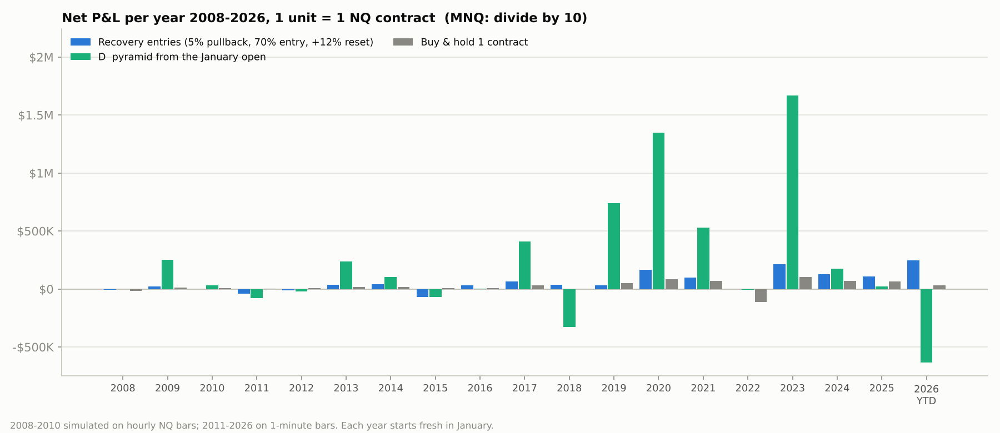

Results in the "x one contract's January value" column remove the effect of the index level (NQ was ~1,200 in 2009 and ~25,000 in 2026), so early and late years are comparable.

| Strategy | 2008-2026 total | Winning years | Worst year | Best year | Average year | Average / std. dev. | Worst drawdown |
|---|---:|---:|---:|---:|---:|---:|---:|
| Buy & hold 1 contract | +$448k | 16 of 19 | -0.44x | +0.55x | +0.17x | 0.65 |  |
| Pyramid from January (D) | +$4.40M | 12 of 19 | -2.55x | +10.52x | +2.02x | 0.55 | -$1.41M |
| Recovery entries | +$1.09M | 13 of 19 | -0.88x | +0.95x | +0.25x | 0.49 | -$374k |
| Recovery entries, run straight through | +$867k | 12 of 19 | -0.42x | +1.18x | +0.30x | 0.62 |  |
| Recovery entries + sell 20-delta 7-day calls | +$1.26M | 14 of 19 | -0.73x | +1.28x | +0.33x | 0.65 | -$346k |
| Recovery entries + sell ATM 30-day calls | +$651k | 13 of 19 | -0.25x | +0.68x | +0.20x | 0.79 | -$320k |

("Average / std. dev." uses each year's result in units of one contract's January value. The worst drawdown is measured on the dollar equity curve, so it comes from the recent, high-priced years.)

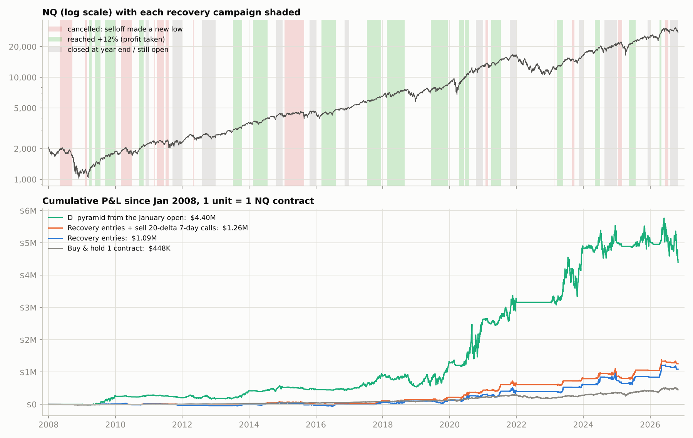

**What the longer history changes:**

- **The recovery version still made money:** +$1.09M per NQ unit (+$109k with MNQ) over 2008–2026, with a worst drawdown of -$374k.
- **"Positive every year" did not survive.** 2022–2026 had no losing year, but over 19 years there were 13 winning and 5 losing years: 2008, 2010, 2011, 2012 and 2015, all choppy years with moderate trends. The worst was 2011 at -0.88x one contract's January value.
- **The all-year pyramid made four times more** (+$4.40M), with a -2.55x year (2018) and -$1.41M drawdowns.
- **Per unit of yearly volatility, neither pyramid beat buy and hold** (0.49 and 0.55 against 0.65). The rules change the shape of the risk; they do not add edge over simply owning NQ.

**Variants (2008–2026, one setting changed at a time):**

| Variant | 2008-2026 total | Losing years | Worst year | Worst drawdown | Campaigns (hit +12%) | Stop-outs | Max contracts |
|---|---:|---:|---:|---:|---:|---:|---:|
| **base: 5% pullback, 70% entry, +12% reset** | **+$1.09M** | 5 | -$70k | -$374k | 44 (17) | 936 | 12 |
| pullback 3% | +$386k | 8 | -$100k | -$531k | 65 (20) | 1362 | 12 |
| pullback 8% | +$1.11M | 5 | -$38k | -$282k | 30 (13) | 675 | 12 |
| pullback 10% | +$781k | 5 | -$111k | -$282k | 21 (9) | 503 | 12 |
| entry at 50% retracement | +$1.41M | 4 | -$65k | -$363k | 72 (23) | 1175 | 12 |
| entry at 61.8% retracement | +$1.45M | 5 | -$66k | -$249k | 52 (20) | 952 | 12 |
| entry at 80% retracement | +$1.00M | 6 | -$152k | -$344k | 37 (16) | 862 | 12 |
| reset at +8% | +$462k | 8 | -$44k | -$144k | 54 (26) | 720 | 8 |
| reset at +16% | +$1.56M | 6 | -$245k | -$702k | 41 (12) | 1134 | 15 |
| reset at +20% | +$2.47M | 6 | -$245k | -$702k | 43 (10) | 1232 | 19 |
| no reset (hold to year end) | +$2.47M | 7 | -$446k | -$1.51M | 30 (0) | 1499 | 45 |
| stop 2% (add every 1%) | +$1.14M | 5 | -$76k | -$392k | 44 (17) | 457 | 12 |
| add every 2%, stop 2% | +$594k | 5 | -$37k | -$226k | 44 (17) | 248 | 6 |
| abandon after 10 stop-outs | +$489k | 11 | -$105k | -$169k | 65 (2) | 502 | 12 |
| abandon after 60 days | +$511k | 9 | -$110k | -$239k | 54 (6) | 723 | 12 |
| single unit (no pyramid) | +$223k | 4 | -$8k | -$54k | 44 (17) | 128 | 1 |

- **The reset level is the main dial.** +20% instead of +12% more than doubled the total (+$2.47M) but nearly doubled the drawdown (-$702k). With no reset at all, the total was the same, with a -$1.51M drawdown.
- **Entering at the 61.8% retracement was best per unit of drawdown:** +$1.45M with -$249k. An 8% pullback trigger gave the same profit as 5% with a smaller drawdown (-$282k). A 3% trigger produced too many false starts: +$386k, with 8 losing years.
- **Abandoning a campaign after 10 stop-outs or 60 days made things worse** (+$489k and +$511k). This was the refinement I suggested last time, and it did not work: the long, choppy campaigns are often the ones that eventually reach +12%.
- **A 2% stop with 1% steps gave the same result with half the stop-outs** (457 against 936): fewer orders, same outcome.
- **A single unit (no pyramid) made +$223k with a -$54k drawdown.** Inside these campaigns, the pyramid multiplies profit by about 5 and drawdown by about 7.

**Covered calls: sell 1 call against every contract held** (priced with Black-76 from VXN, details in `src/options_overlay.py`):

| Overlay | Recovery entries: total | change | worst drawdown | Pyramid from January (D): total | change | worst drawdown |
|---|---:|---:|---:|---:|---:|---:|
| no calls | +$1.09M |  | -$374k | +$4.40M |  | -$1.41M |
| sell ATM 30-day calls | +$651k | -$437k | -$320k | +$3.23M | -$1.17M | -$1.59M |
| sell 20-delta 30-day calls | +$943k | -$145k | -$313k | +$4.29M | -$108k | -$1.32M |
| sell ATM 7-day calls | +$942k | -$146k | -$344k | +$4.18M | -$218k | -$1.32M |
| sell 20-delta 7-day calls | +$1.26M | +$169k | -$346k | +$5.12M | +$727k | -$1.33M |

How much the call result depends on the option-price assumptions (option P&L for the recovery strategy, 2008–2026):

| Calls sold | ATM vol 0.8 x VXN | 0.9 x VXN (base) | 1.0 x VXN | Flatter skew | Steeper skew | 3% spread cost |
|---|---:|---:|---:|---:|---:|---:|
| 20-delta 7-day | -$118k | +$169k | +$423k | +$252k | +$63k | +$148k |
| 20-delta 30-day | -$333k | -$145k | +$22k | -$38k | -$280k | -$184k |
| ATM 7-day | -$504k | -$146k | +$207k | -$160k | -$128k | -$260k |
| ATM 30-day | -$600k | -$437k | -$278k | -$467k | -$399k | -$624k |

- **Selling ATM calls hurts.** -$437k (monthly) on the recovery strategy and -$1.17M on the all-year pyramid. Those calls give away exactly the rallies the pyramid is built to catch. The monthly version loses under every pricing assumption tested.
- **20-delta calls are a coin flip.**
  - Monthly 20-delta calls lost $145k in the base case.
  - Weekly 20-delta calls made +$169k in the base case, but the result ranges from -$118k to +$423k depending only on how richly the calls are priced (ATM vol at 0.8x to 1.0x VXN).
  - That is a bet on selling volatility for more than it later delivers, not an improvement to the pyramid.
- **Weekly NQ options did not exist in 2008–2010**, so the weekly rows are hypothetical for those years.
- **Option P&L is booked when each contract is closed**, so the drawdowns with calls are approximate.

**Hourly vs 1-minute bars, same rules (check for the 2008–2010 data):**

| Year | Recovery, 1-min bars | Recovery, hourly bars | Pyramid from January, 1-min | Pyramid from January, hourly |
|---|---:|---:|---:|---:|
| 2011 | -$39k | -$41k | -$77k | -$72k |
| 2012 | -$12k | -$15k | -$21k | -$3k |
| 2013 | +$35k | +$35k | +$237k | +$238k |
| 2014 | +$42k | +$37k | +$105k | +$74k |
| 2015 | -$70k | -$65k | -$68k | -$59k |
| 2016 | +$32k | +$30k | +$5k | -$4k |
| 2017 | +$65k | +$67k | +$412k | +$367k |
| 2018 | +$37k | +$34k | -$328k | -$302k |
| 2019 | +$32k | +$37k | +$742k | +$723k |
| 2020 | +$167k | +$154k | +$1.35M | +$1.20M |
| 2021 | +$97k | +$83k | +$532k | +$462k |
| 2022 | $0 | $0 | -$7k | -$7k |
| **2011-2022** | **+$386k** | **+$354k** | **+$2.88M** | **+$2.61M** |

Files: `results/long/` (yearly summary, campaigns and trades, variants, covered calls and their stress test, data sources, hourly-vs-1-minute check, daily equity). Code: `src/long_history.py`, `src/run_long.py`, `src/options_overlay.py`, `src/calls_sensitivity.py`, `src/fetch_histdata.py`.

## Breakout entries: beating the 1-year high after a 3% pullback

Same pyramid idea, but entering on a breakout instead of a rebound:

1. **Reference.** The 1-year high: the highest NQ price of the previous 365 days, on the rolled NQ price path, with history before January included.
2. **Setup.** NQ has been at least 3% below that high since it was made.
3. **Entry.** When NQ then trades above the 1-year high, buy 1 unit there (buy-stop at the old high).
4. **Pyramid.** +1 unit every +0.5%. Each unit is stopped 0.5% below its entry and bought again if price climbs back through its level. I read "step 0.5%" as applying to the stop as well, as in the original 1% / 1% rule; a 1% stop is shown as a variant.
5. **Target.** Sell everything at +5% above the entry, then wait for a new 3% pullback.
6. **Cancel.** If NQ falls 3% below the 1-year high again first, sell what is left; the next break of the 1-year high is the new entry.

Same data, costs and years (2008 to Nov 2, 2026; each year starts fresh in January). 1 unit = 1 NQ contract; divide by 10 for MNQ.

| Year | **Breakout as specified** | Campaigns (hit +5% / cancelled) | Stop-outs | Max contracts | Recovery entries | Buy & hold |
|---|---:|---:|---:|---:|---:|---:|
| 2008 | **$0** | 0 (0 / 0) | 0 | 0 | -$9k | -$19k |
| 2009 | **-$4k** | 4 (0 / 3) | 35 | 8 | +$20k | +$13k |
| 2010 | **+$8k** | 3 (2 / 0) | 62 | 10 | -$2k | +$7k |
| 2011 | **-$6k** | 3 (0 / 3) | 24 | 5 | -$39k | +$1k |
| 2012 | **+$6k** | 2 (1 / 1) | 26 | 10 | -$12k | +$6k |
| 2013 | **+$30k** | 3 (3 / 0) | 60 | 10 | +$35k | +$18k |
| 2014 | **+$13k** | 4 (2 / 2) | 73 | 10 | +$42k | +$15k |
| 2015 | **-$14k** | 5 (0 / 5) | 28 | 7 | -$70k | +$6k |
| 2016 | **-$28k** | 3 (0 / 2) | 54 | 7 | +$32k | +$9k |
| 2017 | **+$9k** | 4 (1 / 2) | 38 | 10 | +$65k | +$31k |
| 2018 | **-$42k** | 5 (0 / 5) | 56 | 5 | +$37k | -$4k |
| 2019 | **+$17k** | 4 (1 / 2) | 54 | 10 | +$32k | +$50k |
| 2020 | **+$91k** | 9 (3 / 5) | 83 | 10 | +$167k | +$86k |
| 2021 | **-$3k** | 8 (2 / 6) | 111 | 10 | +$97k | +$71k |
| 2022 | **$0** | 0 (0 / 0) | 0 | 0 | $0 | -$111k |
| 2023 | **-$21k** | 4 (0 / 3) | 46 | 9 | +$211k | +$102k |
| 2024 | **-$28k** | 9 (1 / 8) | 69 | 10 | +$127k | +$70k |
| 2025 | **-$117k** | 4 (0 / 4) | 58 | 9 | +$108k | +$63k |
| 2026 YTD | **+$19k** | 3 (1 / 2) | 45 | 10 | +$246k | +$33k |
| **Total** | **-$72k** | 77 (17 / 53) | 922 | | **+$1.09M** | **+$448k** |

Worst drawdown: **-$289k**. Run straight through instead of restarting each January: -$45k.

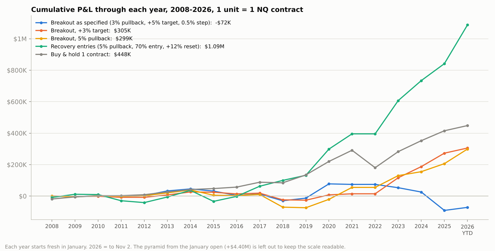

**Variants (one setting changed at a time):**

| Variant | 2008-2026 total | Sum of years, x January value | Losing years | Worst year | Worst drawdown | Campaigns (hit target) | Stop-outs | Max contracts |
|---|---:|---:|---:|---:|---:|---:|---:|---:|
| **base: 3% pullback, +5% target, 0.5% step, 0.5% stop** | **-$72k** | +0.25x | 9 | -$117k | -$289k | 77 (17) | 922 | 10 |
| stop 1% (step 0.5%) | -$13k | +0.81x | 8 | -$111k | -$308k | 77 (17) | 402 | 10 |
| step 1%, stop 1% | -$71 | +0.51x | 9 | -$63k | -$161k | 77 (17) | 220 | 5 |
| target +3% | +$305k | +1.04x | 7 | -$42k | -$95k | 77 (38) | 593 | 6 |
| target +8% | -$169k | -0.81x | 12 | -$124k | -$490k | 77 (5) | 1115 | 16 |
| target +12% | -$270k | -0.45x | 13 | -$124k | -$573k | 77 (1) | 1175 | 23 |
| 5% pullback | +$299k | +0.88x | 6 | -$80k | -$187k | 46 (18) | 849 | 10 |
| no target (hold to year end) | -$287k | -0.80x | 13 | -$124k | -$573k | 77 (0) | 1199 | 28 |

("Sum of years, x January value" adds up each year's result in units of one contract's January value, so the cheap early years count as much as the expensive recent ones. For comparison, buy & hold sums to about +3.2x and the recovery entries to about +4.8x.)

**Pullback × target grid** (0.5% step and stop; 2008–2026 total, then 2008–2015 / 2016–2026 in brackets):

| Pullback before the breakout | Target +2% | Target +3% | Target +4% | Target +5% |
|---|---:|---:|---:|---:|
| 3% | +$94k (+$12k / +$82k) | +$305k (+$24k / +$281k) | +$179k (-$442 / +$179k) | -$72k (+$32k / -$104k) |
| 5% | +$18k (-$9k / +$27k) | +$87k (-$6k / +$93k) | +$306k (-$26k / +$332k) | +$299k (+$5k / +$294k) |
| 8% | +$25k (-$3k / +$27k) | +$139k (+$3k / +$136k) | +$361k (+$23k / +$338k) | +$345k (+$49k / +$296k) |

**What this means:**

- **As specified, the breakout version lost money:** -$72k over 2008–2026, with 9 losing years and a worst drawdown of -$289k.
  - Only 17 of 77 breakouts reached +5%. 53 fell 3% from the high first, so the breakout failed.
  - In level-adjusted terms (+0.25x over 19 years) it is break-even: no edge.
- **Every nearby setting made a little money, but less than simply holding NQ.**
  - The best cells made about +$300k to +$360k over 19 years, against +$448k for buy & hold and +$1.09M for the recovery entries.
  - Almost all of it came after 2016. In 2008–2015, every cell was close to zero.
- **Small or deep is the pattern.** After a 3% pullback, take profits quickly (+3%). After a deeper pullback (5–8%), +4% or +5% targets work. Big targets (+8%, +12%, none) lose: breaks above the old high often fade before running far.
- **0.5% steps mean many more stop-outs:** 922 against 220 with 1% steps. A 1% stop cuts them to 402 and the loss to -$13k.
- **Bottom line:** buying the rebound from a pullback (the recovery entry) worked much better than buying the break above the old high.
- **Data caveat for 0.5% steps:** hourly bars are not reliable here. On 2011–2022, the hourly simulation gave -$86k against +$71k on 1-minute bars. So treat the 2008–2010 breakout numbers as rough (they are small in dollars either way).

Files: `results/breakout/` (yearly summary, campaigns, trades, variants, grid, hourly check). Code: `src/breakout_backtest.py` (rules, with self-tests) and `src/run_breakout.py` (`--grid` for the pullback × target table).

## Recovery entries at 30% of the rebound, with 20-delta calls

Same recovery rules: a 5% pullback arms a wave, 1% step and 1% stop per unit, sell everything at +12% (reset), and cancel on a new low. The only change is the entry: the first unit is bought when NQ has recovered **30%** of the wave (wave low + 30% × (high − low)) instead of 70%. Same data, costs and years (2008 to Nov 2, 2026; each year starts fresh in January). 1 unit = 1 NQ contract; divide by 10 for MNQ.

| Year | NQ move | **Entry at 30%** | Campaigns (hit +12% / cancelled) | Stop-outs | Max contracts | Entry at 70% (previous base) | Buy & hold |
|---|---:|---:|---:|---:|---:|---:|---:|
| 2008 | -44% | **-$13k** | 11 (1 / 10) | 103 | 12 | -$9k | -$19k |
| 2009 | +55% | **+$27k** | 13 (4 / 8) | 207 | 12 | +$20k | +$13k |
| 2010 | +18% | **+$20k** | 6 (2 / 3) | 101 | 12 | -$2k | +$7k |
| 2011 | +2% | **-$47k** | 8 (1 / 6) | 171 | 12 | -$39k | +$1k |
| 2012 | +13% | **+$14k** | 6 (1 / 4) | 47 | 12 | -$12k | +$6k |
| 2013 | +33% | **+$36k** | 2 (1 / 1) | 13 | 12 | +$35k | +$18k |
| 2014 | +21% | **+$88k** | 4 (2 / 1) | 33 | 12 | +$42k | +$15k |
| 2015 | +7% | **+$43k** | 4 (2 / 1) | 92 | 12 | -$70k | +$6k |
| 2016 | +10% | **+$73k** | 11 (2 / 8) | 72 | 12 | +$32k | +$9k |
| 2017 | +32% | **+$70k** | 1 (1 / 0) | 13 | 12 | +$65k | +$31k |
| 2018 | -3% | **-$108k** | 9 (1 / 7) | 146 | 12 | +$37k | -$4k |
| 2019 | +40% | **+$963** | 3 (1 / 2) | 69 | 12 | +$32k | +$50k |
| 2020 | +49% | **+$321k** | 12 (5 / 7) | 198 | 12 | +$167k | +$86k |
| 2021 | +27% | **+$163k** | 9 (2 / 6) | 97 | 12 | +$97k | +$71k |
| 2022 | -34% | **-$251k** | 6 (0 / 6) | 86 | 9 | $0 | -$111k |
| 2023 | +46% | **+$224k** | 7 (2 / 5) | 63 | 12 | +$211k | +$102k |
| 2024 | +21% | **+$325k** | 6 (2 / 3) | 55 | 12 | +$127k | +$70k |
| 2025 | +15% | **-$96k** | 8 (1 / 6) | 89 | 12 | +$108k | +$63k |
| 2026 YTD | +6% | **-$257k** | 9 (1 / 7) | 109 | 12 | +$246k | +$33k |
| **Total** | | **+$634k** | 135 (32 / 91) | 1764 | | **+$1.09M** | **+$448k** |
| x one contract's January value, summed | | +6.64x | | | | +4.82x | +3.16x |

Worst drawdown: **-$534k** (-$374k for the 70% entry). Run straight through instead of restarting each January: +$620k.

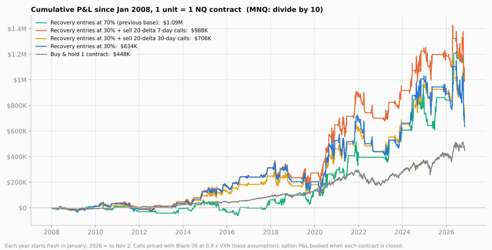

**Every entry level tested (everything else unchanged):**

| Entry at | 2008-2026 total | Level-adjusted sum (x January value) | 2008-2021 | 2022-2026 | Losing years | Worst drawdown | Campaigns (hit +12%) |
|---:|---:|---:|---:|---:|---:|---:|---:|
| 20% | +$1.09M | +7.88x | +$1.05M | +$43k | 5 | -$504k | 234 (38) |
| **30% (this test)** | **+$634k** | +6.64x | +$689k | -$55k | 6 | -$534k | 135 (32) |
| 40% | +$1.16M | +6.61x | +$741k | +$417k | 6 | -$456k | 89 (27) |
| 50% | +$1.41M | +7.33x | +$732k | +$673k | 4 | -$363k | 72 (23) |
| 61.8% | +$1.45M | +7.52x | +$581k | +$869k | 5 | -$249k | 52 (20) |
| 70% (previous base) | +$1.09M | +4.82x | +$396k | +$692k | 5 | -$374k | 44 (17) |
| 80% | +$1.00M | +4.45x | +$292k | +$712k | 6 | -$344k | 37 (16) |
| Buy & hold | +$448k | +3.16x | +$291k | +$157k | | | |

"Level-adjusted" adds up each year's result in units of one contract's January value. This stops the expensive recent years (NQ at 20,000+) from drowning out the cheap early ones (NQ at 1,200–4,000). Since you will trade at today's prices, it is arguably the better guide to a typical year.

**Selling 20-delta calls against every contract held** (30% entry; total, with the option P&L in brackets):

| Overlay | ATM vol 0.8 x VXN | 0.9 x VXN (base) | 1.0 x VXN | Worst drawdown (base) |
|---|---:|---:|---:|---:|
| No calls | | +$634k | | -$534k |
| Sell 20-delta 30-day calls | +$412k (-$222k) | +$706k (+$72k) | +$971k (+$337k) | -$468k |
| Sell 20-delta 7-day calls | +$522k (-$112k) | +$988k (+$354k) | +$1.40M (+$769k) | -$450k |

**What this means:**

- **In dollars, the 30% entry made +$634k:** about 40% less than the 70% entry (+$1.09M), with a bigger worst drawdown (-$534k).
  - It lost $251k in 2022, $96k in 2025 and $257k in 2026.
  - Buying only 30% into a rebound means buying many bounces that fail: 91 of 135 campaigns were cancelled by a new low.
- **Level-adjusted it looks better** (+6.64x against +4.82x), because its good years were the earlier, cheaper ones. The chart shows it was ahead of the 70% entry for most of 2014–2025 and fell behind only in 2026.
- **There is a regime split.** Early entries (20–40%) did best before 2022 and worst since; late entries (70–80%) did the opposite.
- **50–62% is the only zone that did well in both periods:** +$1.41M to +$1.45M, level-adjusted +7.3x to +7.5x, with drawdowns of -$249k to -$363k. This was chosen with hindsight, so treat it as the region to prefer rather than an optimum.
- **20-delta calls helped the 30% version in the base case:** +$72k (monthly) and +$354k (weekly), with smaller drawdowns.
  - If the calls are priced a little cheaper (0.8x VXN), both lose money (-$222k and -$112k).
  - Same verdict as before: a bet on option prices rather than a reliable improvement. Covered-call funds on the Nasdaq-100 have generally lagged the index in strong markets.

Files: `results/recovery30/` (yearly summary, campaigns, trades, entry-level neighbours, covered calls with the pricing stress test, daily equity). Code: `src/run_variant.py`, a reusable runner for any recovery setting, e.g. `--retrace 0.30 --neighbors retrace=0.2,0.4,0.5`.

## Variants (same data, same costs)

| Year | D as specified | E = D, max 10 contracts | B re-buys below January price | A first unit not stopped | Buy & hold |
|---|---:|---:|---:|---:|---:|
| 2022 | -$7k | -$7k | -$1.29M | -$114k | -$111k |
| 2023 | +$1.67M | +$829k | +$1.98M | +$1.67M | +$102k |
| 2024 | +$175k | +$304k | +$398k | +$179k | +$70k |
| 2025 | +$23k | +$205k | +$2.50M | +$61k | +$63k |
| 2026 YTD | -$633k | -$72k | -$107k | -$608k | +$33k |
| **Total** | **+$1.23M** | **+$1.26M** | **+$3.48M** | **+$1.19M** | **+$157k** |
| Worst drawdown | -$1.41M | -$756k | -$2.20M | -$1.41M | |
| Max contracts | 39 | 10 | 46 | 39 | 1 |

* **D (as specified):** every unit has a 1% stop. Units are bought at the January price and at every +1% level above it. A stopped unit is bought again if price climbs back through its level.
* **E:** same as D, but never more than 10 contracts open.
* **B:** same stops, but a unit is bought on every +1% step at any price, including rebounds from below the January price.
* **A:** the first unit is held all year with no stop (only the added units have stops). This was my first reading of the rule. In 2022 it lost the full buy-and-hold amount, -$114k.

Trade logs: `results/trades/<variant>_<year>.csv`. Hourly equity and contracts held: `results/equity/`. All statistics: `results/summary_all_variants.csv`.

## Year by year

Each chart shows NQ, the contracts held, and cumulative P&L for D (as specified) and B (re-buys below the January price).

**2022 (NQ -33.8%).** On January 3 the first unit was bought at 16,387. On January 4, a +1% move added a second unit at 16,551, and later that day both were stopped at -1% (about -$3.3k each). NQ never came back to the January price (the best it did afterwards was about 2.4% below it), so no unit was bought again: **-$7k**. B kept buying every 1% bounce in the falling, volatile market and was stopped 505 times: -$1.29M.
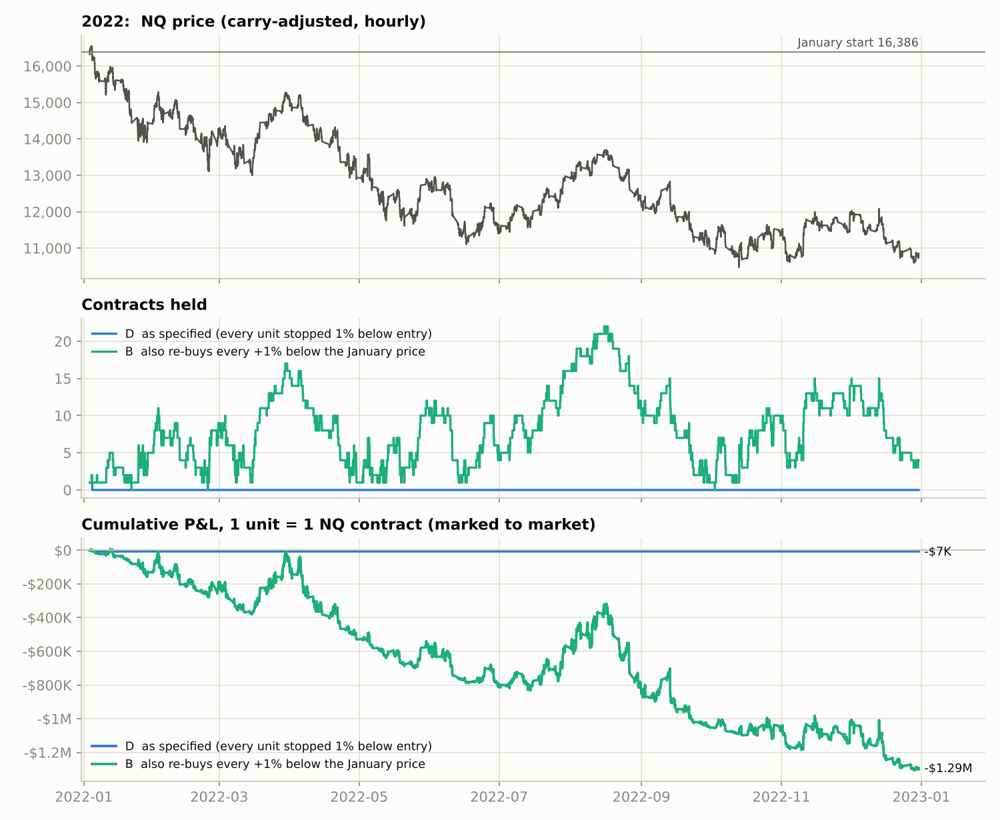

**2023 (NQ +45.9%).** This is the case the strategy is built for: a steady trend at about 18% volatility. The pyramid reached 39 contracts. 160 whipsaws cost $435k, but the units still held made $2.10M. Even so, the August to October correction took $1.34M off the peak.
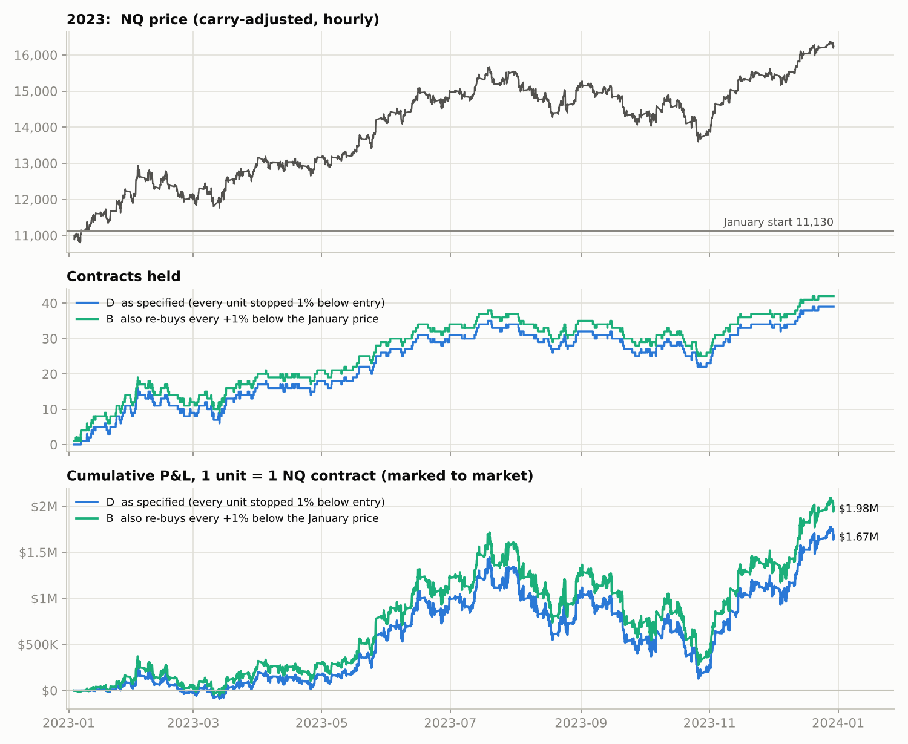

**2024 (NQ +20.7%).** A good year for the index but a choppy one, including the July and August selloff. 142 whipsaws (-$539k) against +$714k from the units still held gave a result of +$175k, just above break-even.
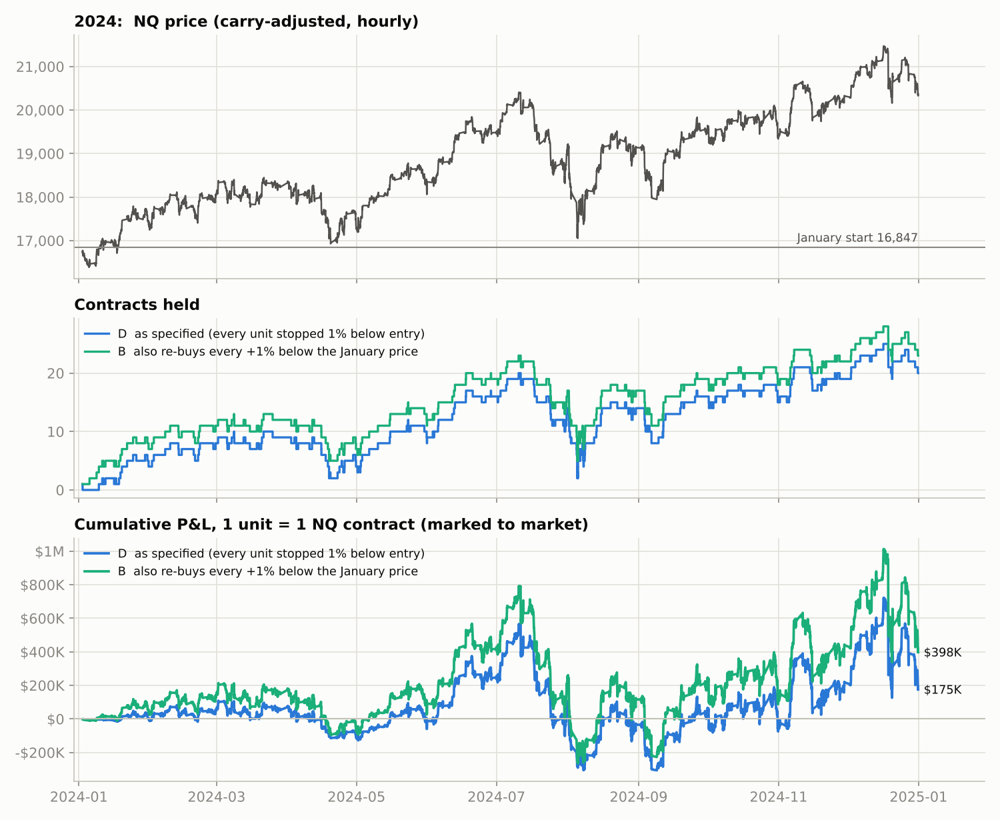

**2025 (NQ +14.8%).** NQ chopped around its January price in January and February, so the first unit was stopped and bought back 8 times. The tariff crash then took NQ about 24% below that price, and D held nothing from late February until NQ climbed back to the January price. The first unit was bought for the last time on June 3, and the pyramid was built on the way up from there. The result was +$23k. B, which also buys below the January price, caught the whole V-shaped rebound: +$2.50M.
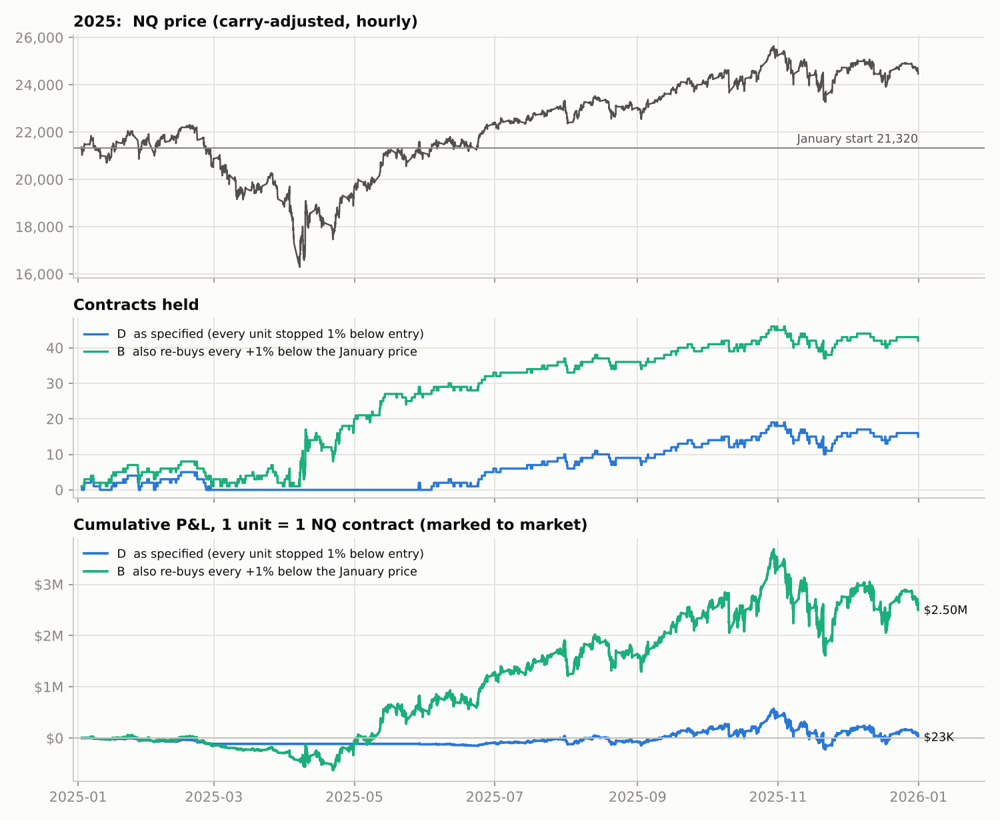

**2026 to November 2 (NQ +6.4%).** NQ chopped around its January price in January and early February (the first unit was stopped five times, and bought for the last time on April 14), dipped about 10% below it in March, rallied to about 19% above the January price by June, chopped between roughly 27,000 and 31,000, made its high on October 6 (+20%), then fell about 11% by November 2. That produced 130 whipsaws at high price levels (about $5.8k each) against only +6% of net trend: -$633k, after having been +$770k in June. The year is not over.
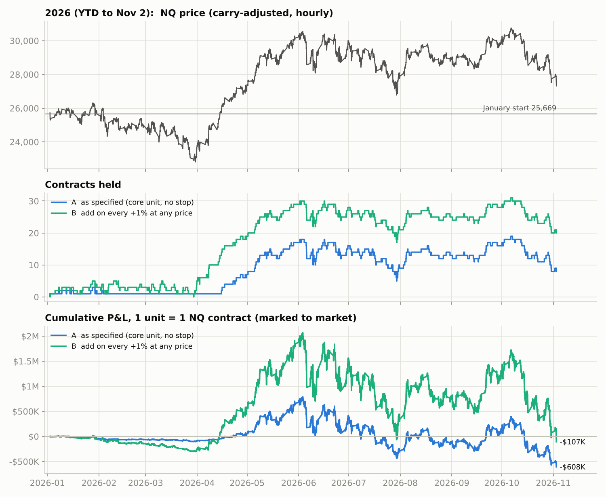

## Why it behaves like this

In variant D, the number of open units is (almost exactly) a function of price: one per 1% level between the January price and the current price. That makes the pyramid a convex, option-like position. Its cost is paid through whipsaws: each time price falls through a level and climbs back, you lose about 1%. Counting grid crossings (equivalently, applying Itô's formula) gives:

```
stop-outs     ≈ RV / (2·d²)                    d = ln(1.01), RV = realised variance of ln(price)
                                               while the ladder is active
whipsaw cost  ≈ stop-outs × 1% × price
trend payoff  = Σ (P_end − L_k) over levels between anchor and P_end  ≈ price × ln(P_end/anchor)² / (2d)

ladder P&L    ≈ price / (2d) × [ ln(P_end/anchor)²  −  RV ]
```

The anchor is the January price for D, and the year's low for B. The **edge ratio** is ln-move² ÷ RV: above 1 the pyramid makes money, below 1 it loses. Checked against the 1-minute backtest:

| Year | Variant | Move from anchor | (log move)² | Realised variance | Edge ratio | Stop-outs predicted / actual | Ladder P&L predicted / actual |
|---|---|---:|---:|---:|---:|---:|---:|
| 2022 | D | -33.8% | 0.0000 | 0.0003 | 0.00 | 2 / 2 | -$5k / -$7k |
| 2022 | B | +3.6% | 0.0012 | 0.1003 | 0.01 | 507 / 505 | -$1.28M / -$1.29M |
| 2023 | D | +45.9% | 0.1425 | 0.0321 | 4.43 | 162 / 160 | +$1.65M / +$1.67M |
| 2023 | B | +50.3% | 0.1658 | 0.0331 | 5.01 | 167 / 166 | +$1.85M / +$1.98M |
| 2024 | D | +20.7% | 0.0354 | 0.0305 | 1.16 | 154 / 142 | +$133k / +$175k |
| 2024 | B | +24.1% | 0.0466 | 0.0308 | 1.51 | 156 / 144 | +$278k / +$398k |
| 2025 | D | +14.8% | 0.0189 | 0.0205 | 0.93 | 103 / 96 | -$1k / +$23k |
| 2025 | B | +50.2% | 0.1653 | 0.0584 | 2.83 | 295 / 262 | +$2.33M / +$2.50M |
| 2026 YTD | D | +6.4% | 0.0039 | 0.0260 | 0.15 | 131 / 130 | -$629k / -$633k |
| 2026 YTD | B | +19.8% | 0.0326 | 0.0365 | 0.89 | 184 / 180 | -$210k / -$107k |

(RV here is the sum of squared 60-minute log returns, counted while the pyramid can hold units: above the first unit's stop for D, all year for B.) Practical consequences:

* **Watch the ratio during the year.** Track (ln(P/P0))² against the realised variance accumulated so far. If price spends months grinding around a level, the stop-out count keeps rising while the trend term does not.
* **Changing the step does not change the sign of the result.** The trend payoff and the whipsaw cost both scale with 1/step, so a different step size does not turn a losing year into a winning one.
* **There is no free lunch.** On a driftless market the two terms cancel in expectation, which is the classic "stop-loss / start-gain" paradox. Whatever edge exists comes from NQ's upward drift, which buy and hold also captures.

## Sensitivity: step and stop size (variant D)

| Add every | Stop | 2022 | 2023 | 2024 | 2025 | 2026 YTD | 5-yr total | Worst drawdown | Stop-outs (5 yrs) | Max contracts |
|---:|---:|---:|---:|---:|---:|---:|---:|---:|---:|---:|
| 0.5% | 0.5% | -$8k | +$3.28M | +$230k | +$65k | -$1.22M | +$2.36M | -$2.73M | 2090 | 78 |
| 0.5% | 1% | -$13k | +$3.32M | +$286k | +$64k | -$1.22M | +$2.44M | -$2.79M | 1024 | 78 |
| 0.5% | 2% | -$20k | +$3.43M | +$289k | +$48k | -$1.22M | +$2.52M | -$2.88M | 491 | 78 |
| 0.5% | 3% | -$30k | +$3.53M | +$313k | +$89k | -$1.19M | +$2.71M | -$2.85M | 305 | 78 |
| 1% | 0.5% | -$5k | +$1.63M | +$109k | +$79k | -$614k | +$1.20M | -$1.40M | 1045 | 38 |
| **1%** | **1%** | -$7k | +$1.67M | +$175k | +$23k | -$633k | **+$1.23M** | -$1.41M | 530 | 39 |
| 1% | 2% | -$13k | +$1.74M | +$154k | +$37k | -$635k | +$1.29M | -$1.48M | 252 | 39 |
| 1% | 3% | -$20k | +$1.79M | +$161k | +$51k | -$624k | +$1.36M | -$1.48M | 158 | 39 |
| 2% | 0.5% | -$3k | +$813k | +$112k | +$28k | -$291k | +$659k | -$708k | 517 | 19 |
| 2% | 1% | -$3k | +$866k | +$123k | -$522 | -$290k | +$695k | -$711k | 264 | 20 |
| 2% | 2% | -$7k | +$883k | +$99k | +$18k | -$287k | +$706k | -$742k | 129 | 20 |
| 2% | 3% | -$10k | +$910k | +$110k | +$16k | -$288k | +$739k | -$737k | 82 | 20 |
| 3% | 0.5% | -$3k | +$601k | +$92k | +$37k | -$211k | +$515k | -$497k | 347 | 14 |
| 3% | 1% | -$3k | +$602k | +$93k | +$34k | -$206k | +$520k | -$496k | 175 | 14 |
| 3% | 2% | -$7k | +$638k | +$85k | +$48k | -$154k | +$610k | -$483k | 76 | 14 |
| 3% | 3% | -$10k | +$625k | +$85k | +$9k | -$172k | +$538k | -$507k | 54 | 14 |

The year-by-year pattern (2023 big, 2024 and 2025 small, 2026 negative) is the same for every step and stop. Only the scale changes.

**Cap on contracts held at once (variant D, 1%/1%):**

| Max contracts | 2022 | 2023 | 2024 | 2025 | 2026 YTD | 5-yr total | Worst drawdown |
|---:|---:|---:|---:|---:|---:|---:|---:|
| 5 | -$7k | +$467k | +$242k | +$118k | +$35k | +$855k | -$386k |
| 10 | -$7k | +$829k | +$304k | +$205k | -$72k | +$1.26M | -$756k |
| 20 | -$7k | +$1.38M | +$221k | +$23k | -$633k | +$984k | -$1.41M |
| 30 | -$7k | +$1.64M | +$175k | +$23k | -$633k | +$1.20M | -$1.41M |
| none | -$7k | +$1.67M | +$175k | +$23k | -$633k | +$1.23M | -$1.41M |

With a cap, once price is far above the last level you are allowed to buy, the strategy holds a fixed block of contracts with no whipsaws at the top. That helped in the choppy years (2024 to 2026) and cost upside in the clean trend year (2023).

## 40-year context (model estimate, not a tick-level backtest)

Free 1-minute data only goes back to 2022 here, so `src/history_estimate.py` applies the formula above to daily Nasdaq-100 data from 1986 to 2025. Carry is the T-bill rate minus 0.7%, reset each January, with no extra financing spread. For 2022 to 2026 that formula gives the same sign as the 1-minute backtest in every year. For variant D it is within about ±0.8 of one contract's January value per year; for B the misses are larger, up to 1.8 in 2025. Treat it as a rough base rate. Results are in **multiples of one contract's January value** (×1.0 = one contract's value at the start of the year):

| Period | Strategy | Years positive | Median year | Mean year | Std dev | Mean / std | Worst year | Best year |
|---|---|---:|---:|---:|---:|---:|---:|---:|
| 1986-2025 | D as specified (every unit stopped) | 19/40 | -0.04× | +2.28× | 6.45× | 0.35 | -4.97× | +29.76× |
| 1986-2025 | A first unit without a stop | 19/40 | -0.08× | +2.32× | 6.45× | 0.36 | -5.02× | +29.76× |
| 1986-2025 | B add at any price | 24/40 | +0.48× | +2.32× | 8.24× | 0.28 | -16.24× | +29.76× |
| 1986-2025 | buy & hold 1 contract | 31/40 | +0.15× | +0.16× | 0.31× | 0.50 | -0.43× | +0.97× |
| 2000-2025 | D as specified (every unit stopped) | 13/26 | +0.03× | +1.34× | 3.62× | 0.37 | -4.97× | +10.06× |
| 2000-2025 | A first unit without a stop | 13/26 | +0.02× | +1.38× | 3.65× | 0.38 | -5.02× | +10.27× |
| 2000-2025 | B add at any price | 16/26 | +0.72× | +1.11× | 6.86× | 0.16 | -16.24× | +17.14× |
| 2000-2025 | buy & hold 1 contract | 19/26 | +0.16× | +0.11× | 0.29× | 0.36 | -0.43× | +0.54× |

Per-year values are in `results/history_estimate_1986_2026.csv`. The worst year for D was 2000: the index rose about 20% above its January level, built a pyramid, then crashed. B's worst year was also 2000, at -16×, from buying every bounce down. In bear years such as 2008 and 2022, D lost almost nothing, because the first unit is stopped early and price never returns to the January level.

## Rules exactly as tested

1. **Start:** at the 09:30 ET open of the first January session, buy 1 unit with a stop 1% below its entry.
2. **Levels:** L_k = P0 × 1.01^k (k = 0, 1, 2, ...). Each level is 1% above the previous one, so "after +1%" is always measured from the previous unit's entry. Buy-stop orders sit at every level that has no open unit. In D and E, levels exist only at and above the January price; in B they exist everywhere.
3. **Stops:** each unit is sold at its entry × 0.99. When that happens, only that unit is closed. If price climbs back through its level, the unit is bought again. There is at most one unit per level. If everything has been stopped, D buys again only when price climbs back to the January price.
4. **End:** sell everything at the 16:00 ET close of the last December session (Dec 30, 2022; Dec 29, 2023; Dec 31, 2024; Dec 31, 2025). For 2026, positions are valued at the Nov 2, 2026 close.
5. **Execution:** 1-minute bars. An up bar is assumed to trade open → low → high → close, a down bar open → high → low → close. Stops and buy-stops fill at their trigger price plus 0.5 pt slippage. If a gap jumps over a trigger (weekend, overnight, news), the fill is at the gap open: for example, the weekend tariff gap of Feb 2, 2025 cost 2.8% instead of 1% on one unit. Commission is $2.50 per contract per side. Stops are live 23 hours a day, as on CME Globex.

## Data and method

* **Price path:** 1-minute bid and ask candles of the Dukascopy Nasdaq-100 CFD (`USATECHIDXUSD`), converted to mid prices: 1.66M bars from Dec 27, 2021 to Nov 2, 2026. Free intraday NQ history going back to 2022 is not available. The CFD trades nearly 24 hours like NQ and tracks the index closely, per [`results/data_validation.md`](results/data_validation.md):
  * 16:00 ET price versus the official NDX close: median -0.1 bp.
  * Daily return correlation: 0.997.
  * Average daily high-low range: 2.03% versus 2.06% for NQ futures.
  * The largest 1-minute moves line up with real events (CPI releases, the April 2025 tariff shocks, the 2026-03-23 spike that also appears in NQ futures).
* **NQ conversion:** each year, prices are scaled to the NQ front-month level on the first day. Futures financing carry is then subtracted: the 13-week T-bill rate minus a 0.7% dividend yield, plus a per-year spread calibrated so that each year's move equals the **real rolled NQ contract** (Yahoo NQ=F with roll jumps removed). The calibrated spreads are -0.45% (2022), +0.89%, +0.42%, +1.06% and +0.80% per year. Without the carry adjustment, the cash index would overstate NQ's yearly gain by about 700 to 970 points in 2023 to 2026.
* **What this means in practice:** P&L is the P&L of an NQ position rolled every quarter. If you trade it live, roll every open unit at the quarterly roll and shift its stop by the roll spread.

## Reproduce

```bash
pip install -r requirements.txt
```

```bash
python3 src/fetch_dukascopy.py --out data/dukascopy --start 2021-12-27 --end 2026-11-02
```

```bash
python3 src/fetch_yahoo.py --out data/yahoo
```

```bash
python3 src/run_backtests.py --cfd data/dukascopy/USATECHIDXUSD_1min_mid.csv.gz --yahoo data/yahoo --out results
```

```bash
python3 src/theory_check.py --results results && python3 src/history_estimate.py --yahoo data/yahoo --results results
```

```bash
python3 src/run_recovery.py --cfd data/dukascopy/USATECHIDXUSD_1min_mid.csv.gz --yahoo data/yahoo --out results
```

For 2008–2026, also download HistData (2010–2025) and the hourly NQ file (two parts, `part_p1.csv` and `part_p2.csv`, from huggingface.co/datasets/Sjdsafari/Nasdaq_60min_2007_to_2023) into `data/hf_nasdaq60`:

```bash
python3 src/fetch_histdata.py --out data/histdata --start 2010 --end 2025
```

```bash
python3 src/run_long.py --dukascopy data/dukascopy/USATECHIDXUSD_1min_mid.csv.gz --histdata data/histdata/NSXUSD_1min.csv.gz --hf data/hf_nasdaq60 --yahoo data/yahoo --out results
```

```bash
python3 src/calls_sensitivity.py --dukascopy data/dukascopy/USATECHIDXUSD_1min_mid.csv.gz --histdata data/histdata/NSXUSD_1min.csv.gz --hf data/hf_nasdaq60 --yahoo data/yahoo --out results
```

```bash
python3 src/run_breakout.py --dukascopy data/dukascopy/USATECHIDXUSD_1min_mid.csv.gz --histdata data/histdata/NSXUSD_1min.csv.gz --hf data/hf_nasdaq60 --yahoo data/yahoo --out results
```

```bash
python3 src/run_breakout.py --grid --dukascopy data/dukascopy/USATECHIDXUSD_1min_mid.csv.gz --histdata data/histdata/NSXUSD_1min.csv.gz --hf data/hf_nasdaq60 --yahoo data/yahoo --out results
```

```bash
python3 src/run_variant.py --name recovery30 --retrace 0.30 --neighbors retrace=0.2,0.4,0.5 --dukascopy data/dukascopy/USATECHIDXUSD_1min_mid.csv.gz --histdata data/histdata/NSXUSD_1min.csv.gz --hf data/hf_nasdaq60 --yahoo data/yahoo --out results
```

```bash
python3 src/run_sizing.py --dukascopy data/dukascopy/USATECHIDXUSD_1min_mid.csv.gz --histdata data/histdata/NSXUSD_1min.csv.gz --hf data/hf_nasdaq60 --yahoo data/yahoo --out results
```

```bash
python3 src/run_best_calls.py --dukascopy data/dukascopy/USATECHIDXUSD_1min_mid.csv.gz --histdata data/histdata/NSXUSD_1min.csv.gz --hf data/hf_nasdaq60 --yahoo data/yahoo --out results
```

```bash
python3 src/make_charts.py --results results && python3 src/report_tables.py --results results
```

The Dukascopy download (about 3,500 small files) throttles. The script retries and resumes from its cache. The engine self-tests run with `python3 src/pyramid_backtest.py`, `python3 src/recovery_backtest.py`, `python3 src/breakout_backtest.py` and `python3 src/options_overlay.py`.

## Files

| Path | What |
|---|---|
| `src/pyramid_backtest.py` | Event-driven engine: grid, per-unit stops, fills, costs, equity curve; self-tests |
| `src/nq_series.py` | CFD to NQ-equivalent conversion: level scaling and calibrated carry |
| `src/run_backtests.py` | Runs every year and variant, plus the step/stop and cap sensitivity grids |
| `src/theory_check.py` | Closed-form prediction versus backtest |
| `src/history_estimate.py` | 1986 to 2025 model estimate from daily data |
| `src/recovery_backtest.py`, `src/run_recovery.py` | Recovery-entry version: rules, fills, self-tests; runner and sensitivity |
| `src/long_history.py`, `src/run_long.py` | 2008–2026: stitched yearly NQ series from three sources; recovery strategy, variants, covered calls |
| `src/run_best_calls.py` | The chosen version at $100k per unit, with 20-delta 30-day / 7-day calls and the option-price stress test |
| `src/run_sizing.py` | Every version at $100k per unit (no reinvestment): Calmar ranking, drawdowns, daily equity |
| `src/run_variant.py` | Any recovery setting on 2008–2026 in one command: both modes, neighbours, 20-delta calls with a pricing stress test |
| `src/breakout_backtest.py`, `src/run_breakout.py` | 1-year-high breakout version: rules (with self-tests), runner, variants and grid |
| `src/options_overlay.py`, `src/calls_sensitivity.py` | Covered-call overlay (Black-76 priced from VXN, with self-tests) and its stress test |
| `src/fetch_histdata.py` | HistData 1-minute download, with the timestamp correction |
| `src/make_charts.py`, `src/report_tables.py` | Charts and README tables |
| `src/fetch_dukascopy.py`, `src/build_bars.py`, `src/fetch_yahoo.py` | Data download and decoding |
| `results/` | All CSV outputs, trade logs, hourly equity curves, charts, data validation |

*Backtests are hypothetical. Real fills during fast markets and gaps can be worse than modelled, futures margin requirements change, and past trend years do not predict future ones.*
